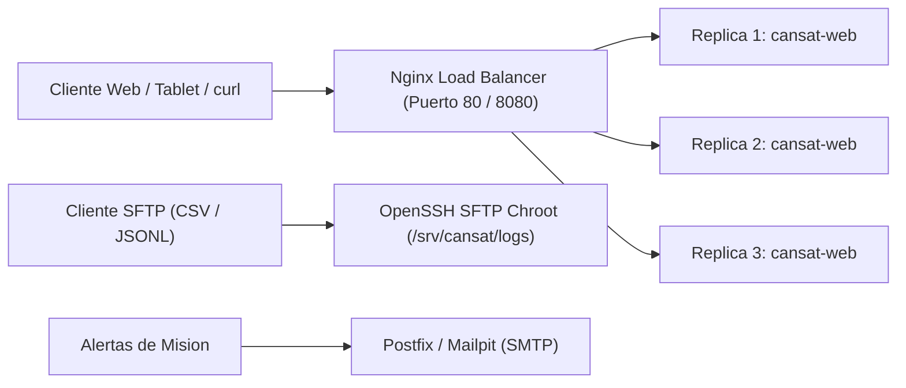
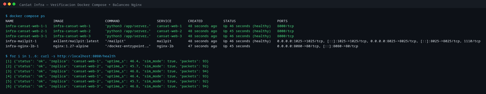
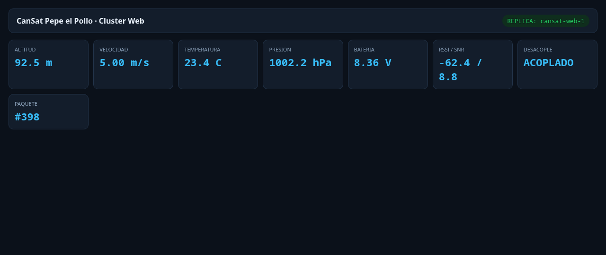
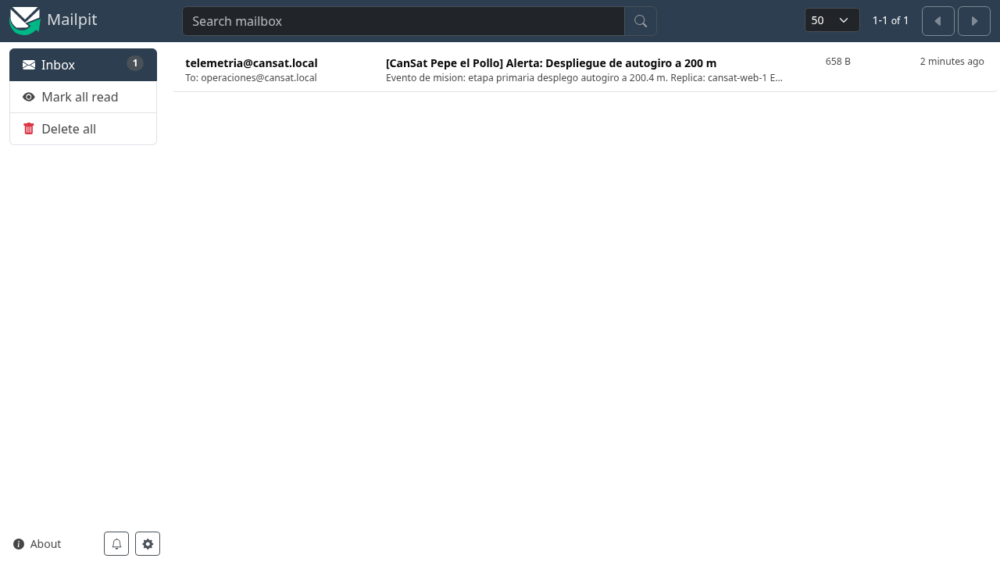

# Infraestructura de Contenedores y Maquinas Virtuales · Proyecto Integrador CanSat

Este repositorio contiene la capa de infraestructura, containerizacion, orquestacion en cluster y servicios de red para el proyecto integrador **CanSat "Pepe el Pollo"**, disenada de forma desacoplada para ejecutarse sobre **Docker**, **Kubernetes (k3s)** y **Maquinas Virtuales (VirtualBox + Vagrant + Ansible)** con orientacion a **balanceo de cargas, replicacion y CI/CD**.

---

## 1. Cumplimiento de los requisitos de la actividad

| Requisito de la actividad | Como se cumple en este repositorio | Archivo(s) |
| --- | --- | --- |
| **Contenedores (Docker)** | Imagen ligera `python:3.11-slim` con usuario no-root (`cansat`) y `HEALTHCHECK` integrado. | `Dockerfile`, `.dockerignore` |
| **Orquestacion y Cluster (Kubernetes)** | Cluster **k3s** (control plane + worker) con `Namespace`, `Deployment` de **3 replicas**, `Service` NodePort y `Ingress`, mas stack local equivalente en Docker Compose. | `k8s/*.yaml`, `docker-compose.yml` |
| **Maquinas Virtuales y automatizacion** | Definicion reproducible de **2 VMs Ubuntu 22.04** (`cansat-master` y `cansat-worker1`) sobre VirtualBox con red privada LAN mediante **Vagrant**. | `Vagrantfile` |
| **Aprovisionamiento de infraestructura** | Playbook de **Ansible** que instala y configura automaticamente todos los paquetes, servicios de red, Docker y la union del cluster k3s. | `ansible/inventory.ini`, `ansible/playbook.yml` |
| **Servicios de red (SSH, SFTP, Nginx, Mail)** | **SSH** activo en ambos nodos; **SFTP** dedicado con chroot en `/srv/cansat/logs` para carga de registros de vuelo; **Nginx** como reverse proxy y balanceador; **Postfix** (en VMs) y **Mailpit** (en Docker Compose) para alertas por correo. | `ansible/playbook.yml`, `nginx/nginx.conf`, `docker-compose.yml` |
| **Orientacion del cluster** | **Balanceo de cargas (`least_conn`) y replicacion (3 replicas)** verificables mediante cabecera `X-CanSat-Replica` y endpoint `/health`. | `nginx/nginx.conf`, `k8s/deployment.yaml`, `app/server.py` |
| **Stack de desarrollo y CI/CD** | Servicio backend/web en Python sin dependencias pesadas + pipeline automatizado en **GitHub Actions** que valida sintaxis, construye la imagen Docker, prueba `/health` y verifica los manifiestos YAML. | `app/server.py`, `.github/workflows/ci-cd.yml` |

---

## 2. Arquitectura general



- **Desacoplamiento:** El ordenador de a bordo (ESP32-S3) y la estacion de escritorio no dependen del cluster para volar en campo. Esta capa consume telemetria en tiempo real (`POST /api/telemetry`) o ejecuta un simulador fisico integrado (`SIM_MODE=1`) para pruebas de carga, replicacion y visualizacion web.

---

## 3. Explicacion del codigo y funciones

### `app/server.py` — Microservicio web de telemetria
Escrito con la biblioteca estandar de Python (`http.server.ThreadingHTTPServer`, `threading`, `queue`, `json`) para mantener la imagen minima y portable entre sistemas operativos.

- **`_publish(packet)`**: Recibe un diccionario de telemetria, inyecta el identificador de replica (`REPLICA_ID = HOSTNAME`), actualiza la altitud maxima y distribuye el paquete de forma thread-safe a todas las colas de clientes SSE conectados.
- **`_simulator_loop()`**: Hilo en segundo plano (activo cuando `SIM_MODE=1`) que genera un perfil de vuelo sintetico de 180 s (ascenso a 450 m, caida libre, apertura de autogiro a 200 m y aterrizaje) con presion barometrica, temperatura, actitud y RSSI/SNR.
- **`TelemetryHandler`** (controlador HTTP):
  - `GET /`: Entrega un dashboard HTML5 autocontenido que muestra las metricas en vivo y el nombre de la replica que atendio la peticion.
  - `GET /health`: Sonda usada por Docker `HEALTHCHECK` y Kubernetes `readinessProbe`/`livenessProbe`. Devuelve `status`, `replica`, `uptime_s` y `packets`.
  - `GET /api/metrics`: Devuelve el ultimo paquete recibido y la altitud maxima acumulada en JSON.
  - `POST /api/telemetry`: Recibe tramas de telemetria externas en formato JSON para integrar el hardware real o scripts de replay.
  - `GET /events`: Canal **Server-Sent Events (SSE)** que transmite telemetria continua sin polling.

### `Dockerfile`
- Usa `python:3.11-slim` como base.
- Crea y ejecuta el proceso bajo el usuario no privilegiado `cansat` (`UID 10001`).
- Expone el puerto `8000` y define un `HEALTHCHECK` cada 15 s contra `/health`.

### `nginx/nginx.conf` y `docker-compose.yml`
- Levanta **3 contenedores independientes** (`cansat-web-1`, `cansat-web-2`, `cansat-web-3`) detras de **`nginx-lb`** en el puerto `8080`.
- Configura el bloque `upstream cansat_backend` con estrategia **`least_conn`** y desactiva el buffering en `/events` (`proxy_buffering off`) para mantener vivo el streaming SSE.
- Incluye **Mailpit** (`1025` SMTP / `8025` Webmail) para validar alertas de correo en ambiente local.

### `k8s/` — Manifiestos de Kubernetes
- **`namespace.yaml`**: Aisla los recursos en el namespace `cansat-infra`.
- **`deployment.yaml`**: Mantiene **3 replicas** de `cansat-web:latest` con limites de recursos (`50m`–`250m` CPU, `64Mi`–`128Mi` RAM) y sondas `readinessProbe` / `livenessProbe`.
- **`service.yaml`**: Expone las replicas mediante `NodePort` en el puerto `30080` de cada nodo.
- **`ingress.yaml`**: Define el enrutamiento HTTP hacia `cansat-web-svc` con `proxy-buffering: "off"` para SSE.

### `Vagrantfile` y `ansible/playbook.yml`
- **`Vagrantfile`**: Provisiona 2 VMs Ubuntu 22.04 en VirtualBox sobre una red privada:
  - `cansat-master` (`192.168.56.10`, 2 vCPU, 2 GB RAM)
  - `cansat-worker1` (`192.168.56.11`, 2 vCPU, 1.5 GB RAM)
- **`ansible/playbook.yml`**: Ejecuta tres bloques ordenados:
  1. **Base comun (`cluster`)**: Instala Docker y OpenSSH, crea el grupo `sftpusers` y el usuario `cansat_sftp` enjaulado (`ChrootDirectory /srv/cansat`) con escritura en `/srv/cansat/logs`.
  2. **Master (`master`)**: Instala Nginx y Postfix (correo local), despliega el servidor **k3s**, construye e importa `cansat-web:latest`, aplica los manifiestos de `k8s/` y configura Nginx como balanceador hacia los puertos `30080` de ambos nodos.
  3. **Worker (`workers`)**: Une `cansat-worker1` al cluster k3s usando el token del master e importa la imagen local.

### `.github/workflows/ci-cd.yml`
- Se dispara en cada `push` o `pull_request` a `main`.
- Verifica la sintaxis de `app/server.py`, construye la imagen Docker, levanta un contenedor temporal para comprobar `GET /health` y valida todos los archivos YAML del repositorio.

---

## 4. Como se construyo (proceso paso a paso)

1. **Separacion del servicio:** Se extrajo la capa web/telemetria en un servidor Python liviano (`app/server.py`) sin dependencias graficas para poder ejecutarlo en entornos Linux headless y contenedores.
2. **Containerizacion:** Se empaqueto el servicio en `Dockerfile` con usuario no-root y chequeo de salud automatico.
3. **Balanceo local:** Se conectaron 3 replicas detras de Nginx (`docker-compose.yml` + `nginx/nginx.conf`) junto con un servidor SMTP de pruebas (`Mailpit`).
4. **Orquestacion en cluster:** Se tradujo el despliegue a manifiestos Kubernetes (`k8s/`) con 3 replicas, sondas y exposicion por `Service` + `Ingress`.
5. **Infraestructura como codigo (VMs + servicios de red):** Se definieron las 2 VMs en `Vagrantfile` y el aprovisionamiento repetible en `ansible/playbook.yml` (SSH, SFTP chroot, Nginx, Postfix, Docker y k3s).
6. **Automatizacion CI/CD:** Se anadio el workflow de GitHub Actions para validar cada cambio de forma automatica.

---

## 5. Montaje y pruebas

### A. Prueba local con Docker Compose (contenedores + Nginx + Mail)

```bash
docker compose up -d --build
docker compose ps
```

- Dashboard balanceado: `http://localhost:8080`
- Interfaz de correo (Mailpit): `http://localhost:8025`

**Verificar balanceo entre replicas:**
```bash
for i in 1 2 3 4 5 6; do curl -s http://localhost:8080/health; echo; done
```
Se debe observar alternancia en el campo `"replica"` (`cansat-web-1`, `cansat-web-2`, `cansat-web-3`).

### B. Montaje en Cluster de VMs + Kubernetes (Vagrant + Ansible + k3s)

```bash
# 1. Crear y arrancar las 2 VMs en VirtualBox
vagrant up
vagrant status

# 2. Aprovisionar SSH, SFTP, Nginx, Postfix, Docker y k3s
ansible-playbook -i ansible/inventory.ini ansible/playbook.yml
```

**Pruebas sobre el cluster y servicios de red:**
```bash
# Estado de nodos y pods (3 replicas Running)
vagrant ssh cansat-master -c "sudo k3s kubectl get nodes -o wide"
vagrant ssh cansat-master -c "sudo k3s kubectl -n cansat-infra get pods,svc,ingress -o wide"

# Balanceo de cargas via Nginx en el master
for i in 1 2 3 4 5 6; do curl -s http://192.168.56.10/health; echo; done

# Prueba de SFTP chroot para subir grabaciones CSV/JSONL
sftp cansat_sftp@192.168.56.10
# Contrasena: cansat2026 -> cd logs -> put archivo.csv

# Prueba de servicio Mail (Postfix)
vagrant ssh cansat-master -c "echo 'Autogiro desplegado a 200 m' | mail -s 'Alerta CanSat' vagrant"
vagrant ssh cansat-master -c "mail -H"
```

---

## 6. Evidencias de ejecucion

### 6.1 Contenedores activos (`healthy`) y balanceo de cargas con Nginx
Las 3 replicas (`cansat-web-1`, `cansat-web-2`, `cansat-web-3`), `nginx-lb` y `mailpit` ejecutandose simultaneamente, junto con 6 peticiones consecutivas a `/health` demostrando la distribucion rotativa entre replicas:



### 6.2 Dashboard web de telemetria servido a traves del balanceador
Interfaz de telemetria en tiempo real (SSE) atendida a traves de Nginx (`http://localhost:8080`) indicando la replica activa (`cansat-web-1`):



### 6.3 Servicio de correo (SMTP / Mailpit) recibiendo alertas de mision
Recepcion de correo de alerta enviado por SMTP (`puerto 1025`) desde el contenedor `cansat-web-1` hacia el servidor de correo (`http://localhost:8025`):


